<picture>
  <source media="(prefers-color-scheme: dark)" srcset="assets/banner-dark.svg">
  
</picture>

 

<picture>
  <source media="(prefers-color-scheme: dark)" srcset="assets/headings/about-dark.svg">
  
</picture>

I'm a Computer Science graduate from the **British University in Egypt (BUE)**, where I specialised in **Artificial Intelligence and Machine Learning**.

The part of AI that hooked me first was **computer vision**. Getting a model to find a face in a webcam frame, or to label every pixel of a street scene, still feels a little bit like magic to me, even after I've seen how the maths works.

Lately I've been pulling on a new thread: **generative and agentic AI**. I've fine-tuned a small LLaMA model with QLoRA, and I build AI-powered workflows in **n8n** and **Make** that take care of real, repetitive tasks, with a human still in the loop.

I like projects that go all the way from *"what if…?"* to something that actually runs. Next, I want to grow that into more hands-on industry and research experience.

> **→ focus:** machine learning · deep learning · computer vision\
> **→ exploring:** generative AI · agentic AI · LLM apps · AI automation\
> **→ open to:** AI/ML roles, internships and research collaborations

 

<picture>
  <source media="(prefers-color-scheme: dark)" srcset="assets/headings/toolkit-dark.svg">
  
</picture>

<table>
  <tr>
    <td width="50%" valign="top"><b>ML &amp; deep learning</b> 
      
      
      
      
      
      
      
       Python · PyTorch · TensorFlow · scikit-learn · pandas · NumPy · Matplotlib · Seaborn · Jupyter
    </td>
    <td width="50%" valign="top"><b>Computer vision</b> 
      
      
      
       OpenCV · YOLO (v5 &amp; v8) · MediaPipe · semantic segmentation (FCN, SegFormer, TransFuse)
    </td>
  </tr>
  <tr>
    <td width="50%" valign="top"><b>LLMs, NLP &amp; agents</b> 
      
      
      
       Hugging Face Transformers · LLM fine-tuning (QLoRA, prompt tuning) · NLP · CrewAI multi-agent systems · Gemini API
    </td>
    <td width="50%" valign="top"><b>AI automation</b> 
      
      
      
      
      
       n8n · Make · webhooks · Gmail, Calendar &amp; Sheets APIs · human-in-the-loop workflows
    </td>
  </tr>
  <tr>
    <td width="50%" valign="top"><b>Web &amp; app development</b> 
      
      
      
      
      
      
      
      
      
       JavaScript · TypeScript · React · Next.js · Node.js · Flask · PHP · HTML/CSS · Flutter &amp; Dart · Firebase
    </td>
    <td width="50%" valign="top"><b>Databases, languages &amp; tools</b> 
      
      
      
      
      
      
       MySQL · MongoDB · SQLite · Firestore · Java · C++ · Git · GitHub · Linux
    </td>
  </tr>
</table>

 

<picture>
  <source media="(prefers-color-scheme: dark)" srcset="assets/headings/projects-dark.svg">
  
</picture>

<table>
  <tr>
    <td width="50%" valign="top">
      <a href="https://github.com/Yara-Hatem/Face-Attendance-System">
        <picture>
          <source media="(prefers-color-scheme: dark)" srcset="assets/projects/face-attendance-dark.svg">
          
        </picture>
      </a>
      
A desktop app for employee attendance that uses <b>real-time face recognition</b>, <b>QR-code login</b> and <b>email verification</b>. Admins register employees, and attendance is tracked and stored automatically. Built during my machine-learning internship.

      
<i>↳ why it's fun:</i> three different ways of proving who you are, working together in one app.

    </td>
    <td width="50%" valign="top">
      <a href="https://github.com/Yara-Hatem/FaceGenderAge-YOLO">
        <picture>
          <source media="(prefers-color-scheme: dark)" srcset="assets/projects/face-gender-age-dark.svg">
          
        </picture>
      </a>
      
Uses <b>YOLO</b> for <b>face detection</b>, then predicts <b>gender</b> and <b>age group</b> for each face it finds.

      
<i>↳ why it's fun:</i> three computer-vision tasks on the same face: find it, then learn something about it.

    </td>
  </tr>
  <tr>
    <td width="50%" valign="top">
      <a href="https://github.com/Yara-Hatem/cityscapes-semantic-segmentation">
        <picture>
          <source media="(prefers-color-scheme: dark)" srcset="assets/projects/cityscapes-segmentation-dark.svg">
          
        </picture>
      </a>
      
A comparative deep-learning study of <b>FCN</b>, <b>SegFormer</b> and <b>TransFuse</b> for 19-class semantic segmentation on <b>Cityscapes</b>, including architectural variants, evaluated with mIoU and pixel accuracy.

      
<i>↳ why it's fun:</i> a classic CNN, a transformer and a CNN–transformer hybrid, compared on the same street scenes.

    </td>
    <td width="50%" valign="top">
      <a href="https://github.com/Yara-Hatem/mental-health-llama-peft">
        <picture>
          <source media="(prefers-color-scheme: dark)" srcset="assets/projects/mental-health-llama-dark.svg">
          
        </picture>
      </a>
      
Fine-tunes <b>LLaMA 3.2-1B</b> for seven-class mental-health text classification using <b>QLoRA</b> and <b>Prompt Tuning</b>, then compares both against the baseline model.

      
<i>↳ why it's fun:</i> two parameter-efficient fine-tuning methods tested side by side on a small LLM.

    </td>
  </tr>
  <tr>
    <td width="50%" valign="top">
      <a href="https://github.com/Yara-Hatem/AI-Production-Inquiry-Agent-n8n">
        <picture>
          <source media="(prefers-color-scheme: dark)" srcset="assets/projects/inquiry-agent-n8n-dark.svg">
          
        </picture>
      </a>
      
An AI-powered email intake automation built with <b>n8n</b>, <b>Google Gemini</b>, <b>Gmail</b> and <b>Google Sheets</b>, It classifies incoming client inquiries, extracts structured project details, and sends automated replies, with human approval, duplicate prevention and error handling.

      
<i>↳ why it's fun:</i> the AI handles the busywork, but a human still gets the final say.

    </td>
    <td width="50%" valign="top">
      <a href="https://github.com/Yara-Hatem/smart-appointment-booking-api-Make">
        <picture>
          <source media="(prefers-color-scheme: dark)" srcset="assets/projects/appointment-booking-make-dark.svg">
          
        </picture>
      </a>
      
An appointment-booking API built with <b>Make</b>, the <b>Google Calendar API</b>, <b>Gmail</b> and <b>webhooks</b>. It validates input, checks availability, keeps booking records, handles duplicates and returns clear API errors.

      
<i>↳ why it's fun:</i> a no-code tool, built with the care of a real backend, right down to SHA-256-based duplicate prevention.

    </td>
  </tr>
</table>

  
<b>more from the notebook</b> (8 more projects: ML, data analysis, GNNs, algorithms)

   

| Project | What it is |
|---|---|
| [Prediction with Graph Neural Networks](https://github.com/Yara-Hatem/Prediction-with-Graph-Neural-Networks) | US traffic-accident severity as a node-classification problem, comparing GNN architectures such as GCN, GAT and GraphSAGE |
| [Warehouse Order Fulfilment](https://github.com/Yara-Hatem/Warehouse-Order-Fullfilment) | An autonomous warehouse-robot simulation: occupancy-grid mapping, A* and Dijkstra path planning, dynamic obstacle avoidance |
| [Airline Passenger Satisfaction](https://github.com/Yara-Hatem/Airline-Passenger-Satisfaction-Binary-Classification) | Binary classification of passenger satisfaction from survey data |
| [House Price Regression](https://github.com/Yara-Hatem/regression-house-prices) | Predicting prices from ~168k property listings across five Pakistani cities |
| [Customer Churn Prediction](https://github.com/Yara-Hatem/ML-DataAnalysis-Dataset) | Predicting which customers are likely to leave a service |
| [Sports Cars Data Analysis](https://github.com/Yara-Hatem/Cars-DataAnalysis) | Data wrangling, web scraping, visualisation and hypothesis testing |
| [Sudoku Solver](https://github.com/Yara-Hatem/Suduko-Solver) | Solving Sudoku with a genetic algorithm and with backtracking |
| [Notification System](https://github.com/Yara-Hatem/Notification-System) | A distributed publish–subscribe notification system using Java RMI |

 

<picture>
  <source media="(prefers-color-scheme: dark)" srcset="assets/headings/exploring-dark.svg">
  
</picture>

<picture>
  <source media="(prefers-color-scheme: dark)" srcset="assets/exploring-dark.svg">
  
</picture>

These are written in pencil on purpose. My strongest foundations are classic ML, deep learning and computer vision; the notes above are what I'm actively learning and building with right now. My first steps are already on this page: the LLaMA fine-tuning project and the n8n and Make automations.

 

<picture>
  <source media="(prefers-color-scheme: dark)" srcset="assets/headings/contact-dark.svg">
  
</picture>

I'm always happy to talk about computer vision, AI automation, or opportunities to learn and contribute.

<a href="https://www.linkedin.com/in/yara-hatem-275b13301/">
  <picture>
    <source media="(prefers-color-scheme: dark)" srcset="assets/contact/linkedin-dark.svg">
    
  </picture>
</a>

  

  <picture>
    <source media="(prefers-color-scheme: dark)" srcset="assets/footer-dark.svg">
    
  </picture>

